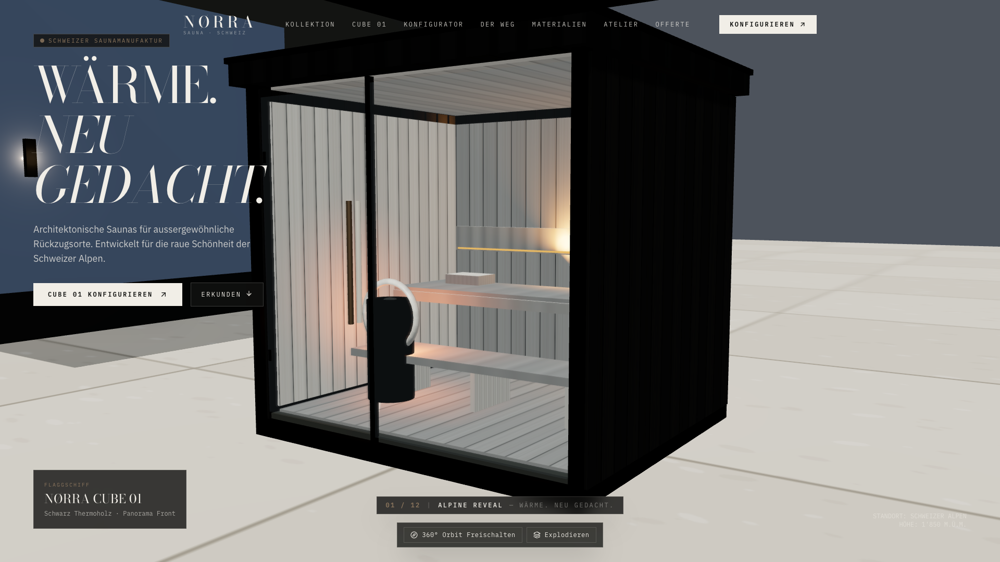

# NØRRA SAUNA — Architectural 3D Commerce Showroom (Schweiz)

> **Architektonische Saunas für aussergewöhnliche Rückzugsorte.**  
> Entworfen und entwickelt für den anspruchsvollen Schweizer Luxusmarkt.



---

## 1. Übersicht & Leitidee

**NØRRA SAUNA** ist eine interaktive 3D-E-Commerce-Demonstration einer architektonischen Outdoor-Sauna (**NØRRA CUBE 01**). 

Das Herzstück der Anwendung ist ein **einziges, persistentes WebGL-Canvas** auf der Homepage:
- Derselbe realistische 3D-Saunakörper begleitet den Besucher kontinuierlich durch **12 filmische Erzählstufen** (vom alpinen Enthüllungsmoment über die Element-Demontage in der Schweizer Manufaktur bis hin zur Ankunft in einer alpinen Villa und dem interaktiven 3D-Konfigurator).
- Kein Neuladen oder Zerstören des WebGL-Kontexts zwischen den Szenen.
- Canvas behält deterministisch 100% der Viewport-Dimensionen und kollabiert zu keinem Zeitpunkt auf den 300px-Standardwert.
- Reversibles Scrollen über GSAP ScrollTrigger: Vor- und Rückwärts-Navigation animiert die 3D-Transformationen synchron.

---

## 2. Die 12 Filmischen Akte der Homepage

1. **Alpine Reveal**: Monumentaler Eröffnungsframe auf einer Natursteinterrasse mit Blick auf das Schweizer Bergpanorama. Parallaxe durch subtile Cursor-Bewegung.
2. **Architektur-Inspektion**: Kamera umrundet die Glasecke; Innenraum und schwebende Bänke werden sichtbar.
3. **Material Close-Up**: Makro-Perspektive auf die tiefschwarze Holzmaserung des thermisch karbonisierten Gebirgsfichtenholzes.
4. **Manufaktur & Elementbau**: Reversible Komponenten-Demontage in einer Schweizer Fertigungshalle (Bodenchassis, Wände, Dämmung, Dach, Panoramaglas, Bänke, Ofen).
5. **Dunkles Produkt-Studio**: Minimalistisches Atelier-Setting mit Studio-Lichtführung. Manuelle 360°-Orbit-Steuerung und Kameraperspektiven.
6. **Schutz & Verpackung**: Vorbereitung für den alpinen Transport mit Schweizer Schutzkantentechnik.
7. **Transit**: Logistikreise über Schweizer Alpenpässe (Graubünden, Berner Oberland, Wallis).
8. **Villa Ankunft**: Ankunft im warmen Licht des Spätnachmittags.
9. **Monolithische Installation**: Plug-and-Heat Einpassung in die Terrassenarchitektur.
10. **Live-Konfiguration**: Direkte Material- und Glaswahl in Echtzeit am persistenten 3D-Modell.
11. **Engineering & Kennwerte**: Dämmwerte (Ug 0.6 W/m²K), Schneelast bis 350 kg/m², 400V / Holzofen-Optionen.
12. **Finale**: Große architektonische Typografie *„DEIN RÜCKZUGSORT. NEU DEFINIERT.“* mit Call-to-Action.

---

## 3. Vollständige Seitenarchitektur (Schweizer Standarddeutsch)

| Route | Inhalt & Funktion |
|---|---|
| `/` | **Homepage** mit kontinuierlichem, persistentem 3D-Erlebnis (12 Akte) |
| `/kollektion` | **Kollektionsübersicht** (CUBE 01, CUBE 01 Compact, CUBE 01 Grand) |
| `/kollektion/cube-01` | **Produktdetailseite** mit eingebettetem 3D-Modell & technischen Spezifikationen |
| `/konfigurator` | **Echtzeit 3D-Konfigurator** (70% 3D-Viewport, Holz-, Glas-, Grössen-, Ofen- & Lichtoptionen, Richtpreise in CHF) |
| `/der-weg` | **Manufakturgeschichte** von der Holzpyrolyse bis zum Helikopter-Einflug |
| `/materialien` | **Interaktive Materialstudie** (Thermoholz, Polarespe, Zeder, 3-fach Isolierglas) |
| `/atelier` | **Markenphilosophie** & Vorstellung des Ateliers an der Gotthardstrasse in Zürich |
| `/offerte` | **Unverbindliche Richtpreis-Kalkulation** (Aufschlüsselung, Transportoptionen Schweiz, Kopieren & Drucken) |
| `/kontakt` | **Showroom Zürich** Kontaktinformationen & Demo-Anfrageformular |
| `/faq` | **Häufige Fragen** (Baubewilligung CH, Fundamente, Elektroanschluss, Schneelast, Umzug) |
| `/impressum` | Rechtliche Angaben nach Schweizer Recht |
| `/datenschutz` | Datenschutzerklärung nach Schweizer Datenschutzgesetz (DSG) |
| `/agb` | Allgemeine Geschäftsbedingungen für Saunabauten in der Schweiz |
| `*` | Custom **404-Fehlerseite** (*„Im Nebel verschollen“*) |

---

## 4. Design- & Materialsystem

- **Farbpalette**:
  - Charcoal (`#111210`)
  - Warm White (`#F1EEE7`)
  - Graphite (`#242521`)
  - Natural Stone (`#C8BFB1`)
  - Thermowood (`#302720`)
  - Bronze (`#8A745C`)
- **Typografie**:
  - *Bodoni Moda* (Editoriale Überschriften)
  - *IBM Plex Sans* (Fliesstexte und Beschreibungen)
  - *IBM Plex Mono* (Spezifikationen, Währungsangaben und Metriken)

---

## 5. Technische Architektur

- **Framework**: React 18, TypeScript (strikter Modus), Vite 5
- **3D / WebGL Engine**: Three.js, `@react-three/fiber`, `@react-three/drei`
- **Animationen**: GSAP 3 mit `ScrollTrigger`
- **Styling**: Tailwind CSS
- **Prozedurale Texturen**: HTML5 Canvas-Generatoren für hochaufgelöste Holzmaserungs-PBR-Texturen, Normal Maps und Rauheitskarten (keine externen CDN-Abhängigkeiten oder defekte Bild-Links)
- **Testing**: Vitest (Unit Tests) & Playwright (End-to-End Visual Audit & Interaktionstests)

---

## 6. Entwicklung & Verifikation

```bash
# Abhängigkeiten installieren
npm install

# Entwicklungsserver starten
npm run dev

# Code-Qualitätsprüfung (ESLint 0 Warnings)
npm run lint

# TypeScript Typprüfung
npx tsc --noEmit

# Unit-Tests ausführen (Vitest)
npm run test

# End-to-End Tests ausführen (Playwright)
npm run test:e2e

# Produktions-Build erstellen
npm run build

# Visuelle Screenshots erfassen
npm run screenshots
```

---

## 7. Visuelle Nachweise (Screenshots)

Alle visuellen Audit-Screenshots liegen im Verzeichnis `public/screenshots/`:

| Dateiname | Beschreibung |
|---|---|
| `01-hero-first-frame.png` | Erster Eröffnungsframe auf der alpinen Steinterrasse (Desktop 1920×1080) |
| `02-hero-camera-movement.png` | Kamera-Annäherung an die Glasecke & Interieur (Akt 2) |
| `03-material-closeup.png` | Makro-Aufnahme der karbonisierten Holzmaserung (Akt 3) |
| `04-factory-assembly.png` | Manufaktur-Explosionszeichnung der Baugruppen (Akt 4) |
| `05-product-studio.png` | Dunkles Produktstudio mit 360°-Kontrolle (Akt 5) |
| `06-shipping-scene.png` | Schweizer Transportvorbereitung mit Schutzkanten (Akt 6 & 7) |
| `07-final-villa-reveal.png` | Finale Einbettung in die Residenz & Markenabschluss (Akt 12) |
| `08-configurator-desktop.png` | 3D-Konfigurator (70% Canvas, Material-, Grössen- & Ofenoptionen) |
| `09-collection-overview.png` | Übersicht der Kollektionsmodelle |
| `10-product-detail.png` | Produktdetailseite NØRRA CUBE 01 mit interaktivem 3D-Viewer |
| `11-mobile-hero.png` | Mobile Hero-Ansicht (390×844) |
| `12-mobile-configurator.png` | Mobiler 3D-Konfigurator mit Touch-Orbit |
